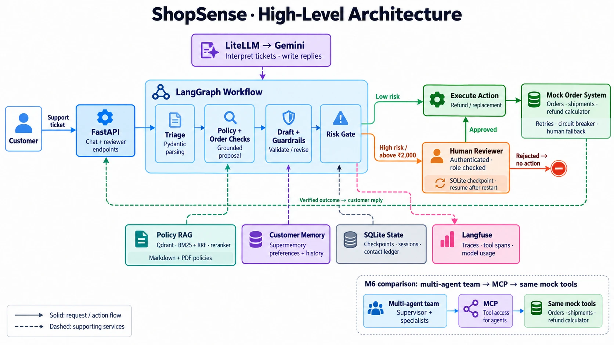

# ShopSense — Customer Care & Order Operations Assistant

IIT Hyderabad Applied AI capstone, problem statement 4 (Kartway e-commerce marketplace).
Architecture, guardrails, evaluation results and known limitations: [docs/ARCHITECTURE.md](docs/ARCHITECTURE.md).



## Stack (as taught in the course)

LiteLLM + Gemini · Pydantic · LangChain / LangGraph (SqliteSaver checkpoints, `interrupt()`) ·
Supermemory · Qdrant Cloud + `gemini-embedding-001` · BM25 + RRF + cross-encoder rerank ·
FastMCP + `langchain-mcp-adapters` · Langfuse (tracing, scores, experiments) · tenacity ·
Ragas / DeepEval / TruLens judges · FastAPI.

## Setup

```bash
uv sync
cp .env.example .env    # fill in Gemini, Supermemory, Qdrant Cloud and Langfuse keys
.venv/bin/python -m shopsense.m3.rag   # builds the Qdrant Cloud index (embeddings are disk-cached)
```

`data/` is read-only input. Everything the system writes goes to `runtime/` (override with `SHOPSENSE_RUNTIME_DIR`).

## Milestones → modules

| Milestone | Module(s) | Check (offline) | Live demo / evidence |
|---|---|---|---|
| M1 Structured intake + repair loop | `m1/parser.py` | `python -m shopsense.m1.parser --offline` | `python -m shopsense.m1.parser`, `… m1.parser --eval` (field accuracy → Langfuse) |
| M2 Tool-enabled agent | `m2/agent.py`, `mock_api`, `reliability` | `… m2.agent --offline` | `… m2.agent` |
| M3 Memory + semantic index | `m3/memory.py`, `m3/rag.py` | `… m3.memory --offline` | `… m3.memory`, `… m3.rag` |
| M4 Production RAG + eval | `m4/hybrid.py`, `m4/rerank.py`, `m4/eval.py` | `… m4.eval --offline` | `… m4.eval` (scores → Langfuse) |
| M5 LangGraph workflow + checkpoint + HITL | `m5/workflow.py` | `… m5.workflow --offline` | `… m5.workflow` (resume in a new process) |
| M6 Multi-agent team + MCP | `m6/team.py`, `m6/mcp_server.py` | `… m6.team --offline` | `… m6.team`, `… m8.eval --engine team` (golden set) |
| M7 Observability + hardening | `tracing`, `reliability`, `m7/observability.py` | `… m7.observability --offline` | `… m7.observability` (spans read back from Langfuse) |
| M8 Eval + guardrails + API | `guardrails`, `m8/eval.py`, `m8/api.py` | `… guardrails`, `… m8.api --offline` | `… m8.eval`, `… m8.api` |

(`…` = `.venv/bin/python -m shopsense.`)

## Run it

```bash
uv run shopsense
```

Then open http://localhost:8000/ui and sign in as a **customer** (customer ID and password; in this demo the password
is the customer ID, e.g. KW-C-00298 / KW-C-00298; leave both empty for a guest) or as **support staff** (`lead`,
`ops` or `finance`, password = username; they may approve refunds up to ₹10,000, ₹50,000 and above). Use one browser
window per person. The same API serves Postman (`demo/ShopSense.postman_collection.json`), Swagger at `/docs`, and
the terminal clients `demo/chat.py` and `demo/review.py`.

| Method | Path | Notes |
|---|---|---|
| GET | `/health` | liveness, no LLM call |
| POST | `/auth/customer` | `{"customer_ref", "password"}` → `{"customer_ref", "token"}` (demo: the password is the customer id) · 401 unknown customer or wrong password |
| POST | `/chat` | `{"message", "session_id"?}` plus header `X-Customer-Token` for a signed-in customer (no token: a guest) → 200 resolved · 202 awaiting human · 422 guardrail block (flags in body) · 409 if the session belongs to another customer · 401 if `customer_ref` is sent without that customer's token · 503 + `Retry-After` when the LLM is rate-limited |
| GET | `/tickets/{ticket_id}/status` | the customer's view of one ticket (status and latest reply); a customer's ticket needs their `X-Customer-Token` |
| GET | `/reviewer/me` | reviewer only: the signed-in reviewer's name and role |
| POST | `/auth/staff` | `{"username", "password"}` → `{"name", "role", "token"}`; the token is the reviewer Bearer token |
| GET | `/ui`, `/ui/customer`, `/ui/support` | sign-in page (Customer or Support staff), customer chat, support console |
| GET | `/tickets/pending` | reviewer only: tickets parked at the human-approval gate |
| POST | `/tickets/{ticket_id}/decision` | reviewer only: `{"action": "approved" \| "rejected" \| "changes_requested", "approver", "note"?, "edited_reply"?}` · 401 no/wrong token · 403 approver mismatch or role below the amount's tier · 409 if not pending or the edited reply fails the reply checks |

Reviewer endpoints need `Authorization: Bearer <token>`: the token from `POST /auth/staff` (`{"username", "password"}`), a named reviewer's token, an SSO token, or `SHOPSENSE_REVIEW_TOKEN`. `approver` must be that reviewer, and an approval needs a role whose refund-matrix tier covers the amount (`team_lead` ≤ ₹10,000, `operations_manager` ≤ ₹50,000, `finance` above). Conversations (`session_id`) are stored in `runtime/sessions.sqlite`; earlier turns are passed to the next ticket as context.

Customers sign in first; the token says who the customer is, so nobody can read another customer's orders by
sending their id. `SHOPSENSE_REQUIRE_CUSTOMER_LOGIN=false` lets a trusted client send `customer_ref` without a token
(development only). Example:

```bash
TOKEN=$(curl -s localhost:8000/auth/customer -H 'Content-Type: application/json' \
  -d '{"customer_ref": "KW-C-00298", "password": "KW-C-00298"}' | python3 -c 'import sys, json; print(json.load(sys.stdin)["token"])')
curl -s localhost:8000/chat -H 'Content-Type: application/json' -H "X-Customer-Token: $TOKEN" \
  -d '{"message": "My furniture order KW-O-000006 came a week late. I want compensation."}'
```

Public demo: `ngrok http 8000` (requires an ngrok authtoken), then point Postman at `<public-url>/chat`.

## Evaluation

- Retrieval (M4): `python -m shopsense.m4.eval [--no-judge] [--no-langfuse]` — precision@k / recall@k / MRR for dense, BM25 alone, hybrid and hybrid+rerank on both the Markdown and the PDF corpus, plus groundedness; scores logged to Langfuse.
- End to end (M8): `python -m shopsense.m8.eval` — 20-ticket golden set [`eval/golden_set_v2.json`](eval/golden_set_v2.json) through the M5 workflow as a Langfuse experiment, scored per pipeline component as in the course template (`component_scorer`): tool use (`tool_call_match`: order looked up, action, reason code, quoted amount), retrieval (citation recall, keyword hit rate, Ragas ContextPrecisionWithReference, TruLens context relevance), routing (`route_match`), final answer (expected facts, DeepEval G-Eval, Ragas Faithfulness, TruLens groundedness) and guardrails on every item. Reports (with a per-component table) land in `runtime/eval_reports/`.
- MCP tool layer (M6): `python -m shopsense.m6.tool_eval` (or `python -m shopsense.m6.mcp_server --eval`) — 20 labelled calls to all 8 tools of the order server (`eval/tool_cases.json`, inputs from the mock tables, exact expected outputs), per-tool accuracy; no model calls, logs in a temporary runtime dir.
- Memory (M3): `python -m shopsense.m3.memory_eval [--offline]` — `eval/memory_cases.json` scored per sub-part: rolling summary keeps order refs, amounts and the stated language; preference recall via `customer_context` (ledger-backed); recall of the preference's long-term copy from Supermemory; third-contact ledger count; reviewer lessons. Live, the summary cases call the configured model and the preference cases use real Supermemory in throwaway `shopsense-eval-<run>-*` containers (polled up to 60 s for indexing, deleted afterwards); `--offline` swaps in a deterministic stub summariser and an in-process store.
- Intake parser (M1): `python -m shopsense.m1.parser --eval [--limit 20] [--no-langfuse]` — parses the first N intake records (read-only) and scores issue type, sentiment, requires-human and order id against each record's `ground_truth` through explicit mapping tables; per-field accuracy + confusion tables to `runtime/eval_reports/m1_intake_eval_*.json`, per-field scores to Langfuse (`intake-eval:m1_parser`).
- Multi-agent team (M6) on the golden set: `python -m shopsense.m8.eval --engine team [--no-judges]` — the same 20 tickets and scorers, run through `m6_team.run_ticket` (one MCP session per ticket) instead of the M5 workflow; Langfuse run `team-run-HHMMSS`, report `runtime/eval_reports/m8_eval_team-*.json`. About 12 model calls per ticket, so use `--no-judges` when the daily quota is tight.
- Golden-set audit (M8): `python -m shopsense.m8.golden_audit [set.json]` — checks every expected answer against the policy documents it cites, with the same figure check as the reply guardrail; our set 0/20 problems, the toolkit's 7/20 (all real errors). No model calls.
- Guardrails in both directions (M8): `python -m shopsense.guardrails --eval` — 34 labelled replies (`eval/guardrail_cases.json`, 16 good, 18 bad); reports false rejections (good replies blocked) and false approvals (bad replies let through) separately. Rules only by default; `--live` adds the independent reviewer model.
- Independent judge (M8): `SHOPSENSE_JUDGE_MODEL=groq/llama-3.3-70b-versatile` (or any LiteLLM model from another provider, with its API key) makes the Ragas, DeepEval and TruLens judges a different model family from the system; `SHOPSENSE_REVIEWER_MODEL` does the same for the M6 fact-checker's second opinion. Every judged report records `judge_model` and `judge_independent`.
- Judge audit (M8): `python -m shopsense.m8.eval --audit-judge-live` runs the G-Eval judge on 20 hand-labelled replies (`eval/judge_audit_cases.json`: for ten golden tickets, one correct reply and one fluent but wrong one) and reports the agreement rate; `--audit-judge <report.json>` compares a run's judge scores with the golden-answer checks.
- Prompt injection, three layers: `python -m shopsense.guardrails --injection` scores the patterns, the Llama Prompt Guard 2 classifier (Groq) and the reviewer model's judgement on 78 labelled tickets (`eval/injection_cases.json`: intake records by id, golden injections, reworded attacks and look-alike innocent messages), detection and false alarms per layer.
- Guardrails with the reviewer model: `python -m shopsense.guardrails --eval --live` adds the model-based commitment check (paraphrased promises) to the rules.
- Canaries and SLOs (M7): `python -m shopsense.m7.canary` (once) or `--every 60`; exit code 2 and an alert on an SLO breach.
- Operations: `SHOPSENSE_AUTOMATION=paused` sends every ticket to `/tickets/pending` (nothing executes); `/chat` is served by the M6 multi-agent team by default (about 12 model calls, 1-1.5 minutes per ticket on the free tier); `SHOPSENSE_ENGINE=workflow` serves the M5 workflow instead (2-3 calls) with the same approval flow; `python -m shopsense.m5.workflow --expire-overdue` (or `POST /tickets/expire`) closes held tickets older than `SHOPSENSE_APPROVAL_TTL_HOURS`; `python -m shopsense.m8.api --add-reviewer NAME ROLE` creates a named reviewer token; trace payloads are redacted before export, tagged with the model and prompt version, and tail-sampled with `SHOPSENSE_TRACE_SAMPLE_RATE`.
- All offline checks: `.venv/bin/python -m pytest tests -q` runs the regression tests and every module's self-check.
- Fault injection (M7): `SHOPSENSE_FAULTS="seed=42,fail=0.2,timeout=0.1,malformed=0.1"` makes the order system flaky for any run.
- Regression tests (offline, no API keys needed): `.venv/bin/python -m pytest tests -q` (pytest is in the `dev` dependency group, installed by `uv sync`).
- Other providers: the chat model is a LiteLLM model string, so `LLM_MODEL=openai/gpt-4o-mini` or `anthropic/claude-sonnet-4-5` (plus that provider's API key) switches every milestone and the M8 judges; `tests/test_regressions.py::test_other_providers_go_through_the_same_code` checks the routing offline. Embeddings are a setting too: `SHOPSENSE_EMBED_MODEL` (any LiteLLM embedding model) uses its own Qdrant collection, built with `python -m shopsense.m3.rag`; the default `gemini-embedding-001` index is untouched. Prompts and thresholds were tuned and measured on Gemini.
- Quotas: Gemini free-tier limits are per model. `SHOPSENSE_LLM_MODEL=gemini/gemini-3.1-flash-lite` overrides `LLM_MODEL` for one run.
- Before a live demo, clear `runtime/` (or point `SHOPSENSE_RUNTIME_DIR` at an empty folder): refunds recorded by earlier runs count as "already refunded" for the same order, so the order system holds a repeat request for a human.
- Return windows are measured to today; `SHOPSENSE_AS_OF=YYYY-MM-DD` pins the reference date for reproducible runs.

## Demo

Web pages served by the API: `/ui` is the sign-in page with two choices, Customer (customer ID and password, the ID itself in this demo; leave both empty for a guest) and Support staff (username and password: lead, ops or finance in this demo). Customers get their chat (`/ui/customer`); staff get the console (`/ui/support`), where escalations appear and update on their own. In terminals, `demo/chat.py` (one window per customer; it asks for the customer ID and password) and `demo/review.py` (the support-staff console; it asks for the staff login) are interactive clients for the running API: a customer's held ticket appears in the console by itself, the reviewer decides it there, and the outcome appears in the customer's window by itself (`GET /tickets/{id}/status`). `demo/` also holds the video kit: `preflight.py` (checks keys, Gemini, Qdrant, Supermemory, Langfuse and the port; `--reset` archives earlier demo state), `demo.py m1` … `m8` (one short segment per milestone, in slide order), `ShopSense.postman_collection.json` (the API walkthrough, including the human-approval flow) and `DEMO_SCRIPT.md` (the minute-by-minute script). Demo state goes to `runtime/demo` (API) and `runtime/demo-cli` (demo.py), never `data/`.
